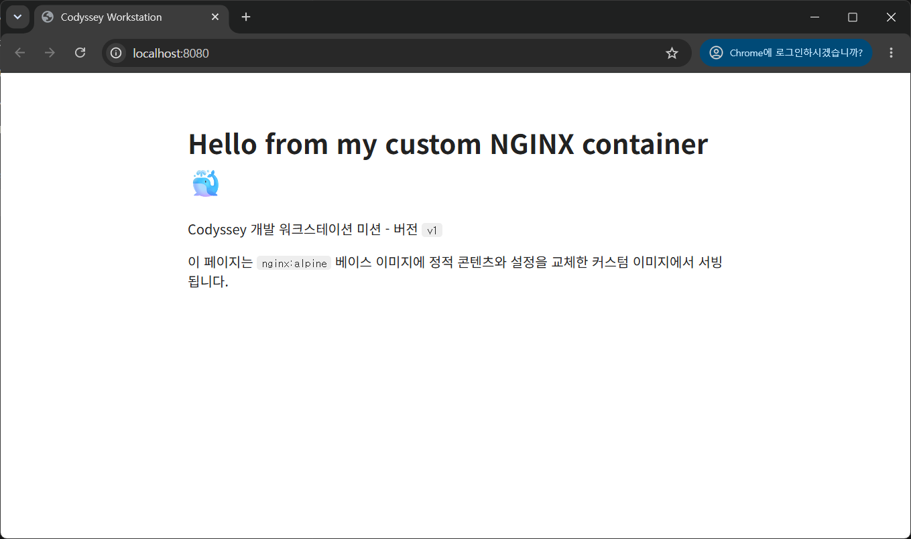
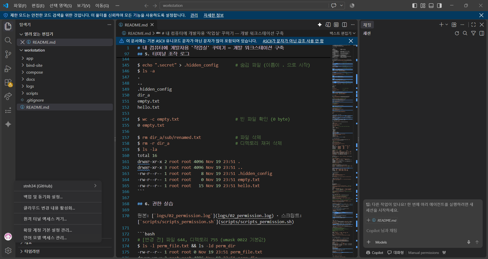
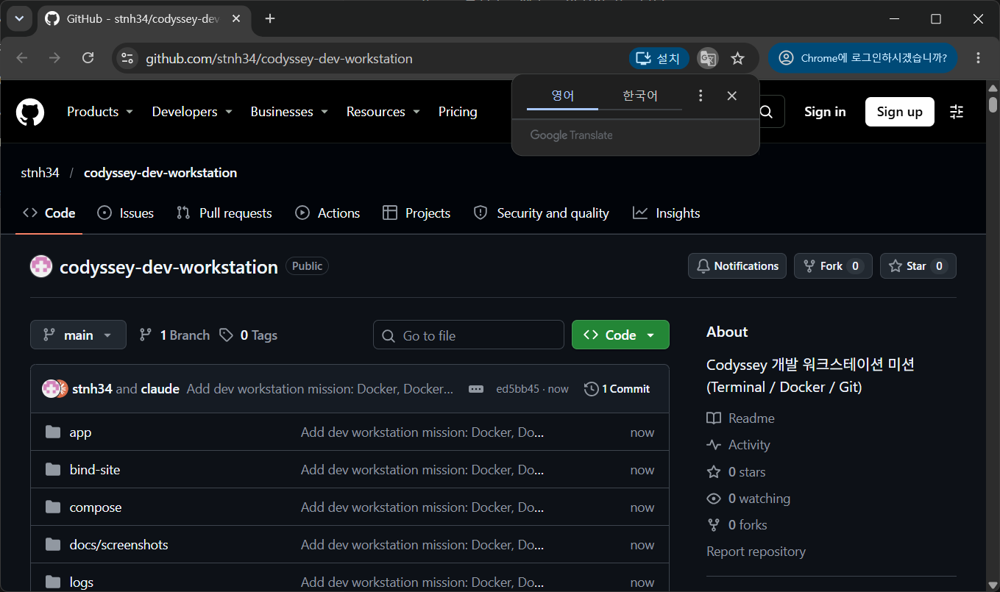

# 내 컴퓨터에 개발자용 '작업실' 꾸미기 — 개발 워크스테이션 구축

> Codyssey 입학연수 · 개발 입문 미션 결과물
> 터미널(Linux CLI) · Docker · Git/GitHub 를 직접 세팅하고, **실행 결과(로그/접속/데이터 유지)** 로 검증한 기록입니다.

## 목차
1. [프로젝트 개요](#1-프로젝트-개요)
2. [실행 환경](#2-실행-환경)
3. [수행 체크리스트](#3-수행-체크리스트)
4. [저장소 구조](#4-저장소-구조)
5. [터미널 조작 로그](#5-터미널-조작-로그)
6. [권한 실습](#6-권한-실습)
7. [Docker 설치 및 기본 점검](#7-docker-설치-및-기본-점검)
8. [Docker 기본 운영 명령](#8-docker-기본-운영-명령)
9. [컨테이너 실행 실습 (hello-world / ubuntu / attach vs exec)](#9-컨테이너-실행-실습)
10. [Dockerfile 커스텀 이미지](#10-dockerfile-기반-커스텀-이미지)
11. [포트 매핑 및 접속 증거](#11-포트-매핑-및-접속-증거)
12. [바인드 마운트 반영](#12-바인드-마운트-반영)
13. [Docker 볼륨 영속성](#13-docker-볼륨-영속성)
14. [Git 설정 및 GitHub/VSCode 연동](#14-git-설정-및-githubvscode-연동)
15. [보너스: Docker Compose / 환경변수](#15-보너스-docker-compose--환경변수)
16. [검증 방법 요약](#16-검증-방법-요약)
17. [트러블슈팅](#17-트러블슈팅)
18. [개념 정리 (과제 목표)](#18-개념-정리-과제-목표)
19. [재현 방법 및 주의사항](#19-재현-방법-및-주의사항)

---

## 1. 프로젝트 개요

| 목표 | 이 저장소에서 한 일 |
|---|---|
| 터미널로 작업 디렉토리/권한 정리 | WSL Ubuntu(bash)에서 생성·복사·이동·삭제, `chmod` 숫자/기호 표기 실습 |
| Docker 설치·점검·운영 | `docker --version`, `docker info`, `images/ps/logs/stats/stop/start` |
| 웹 서버 컨테이너화 | `nginx:alpine` 기반 커스텀 이미지(정적 콘텐츠 + 설정 + 헬스체크) |
| 포트 매핑 | 같은 이미지를 `8080:80`, `8081:80` 으로 2회 실행 → 브라우저/curl 접속 |
| 변경 반영 / 데이터 영속성 | 바인드 마운트로 호스트 수정 즉시 반영, 볼륨으로 컨테이너 삭제 후에도 데이터 유지 |
| 버전 관리·협업 | Git 사용자/기본 브랜치 설정, GitHub 로그인 및 원격 저장소 push |
| 보너스 | Compose 단일/멀티 컨테이너, 서비스 디스커버리, `up/down/ps/logs`, 환경변수 주입 |

모든 원본 로그는 [`logs/`](logs) 폴더에 있고, 아래 본문에는 핵심 부분을 코드블록으로 발췌했습니다.
로그는 `r(){ echo "\$ $*"; eval "$@" 2>&1; }` 형태의 함수로 **명령어와 출력을 함께** 기록했습니다.

## 2. 실행 환경

| 항목 | 값 |
|---|---|
| Host OS | Windows 11 Pro (10.0.26200) |
| Linux 실습 환경 | WSL2 · Ubuntu 26.04.1 LTS (커널 6.18.58.1-microsoft-standard-WSL2) |
| Shell | bash 5.3 (WSL Ubuntu), Git Bash 5.3 (Windows 쪽 docker/git 명령) |
| 터미널 | Windows Terminal / VSCode 통합 터미널 |
| Docker | Docker Desktop · Engine **29.9.3** (Compose v5.7.0, Buildx v0.38.1) |
| Git | **2.56.0.windows.4** |
| GitHub CLI | gh 2.105.0 (미션 수행 중 `winget` 으로 설치) |
| Editor | VSCode 1.146.0 |

> 서울캠퍼스(macOS + OrbStack) 환경이라면 Docker Desktop 대신 OrbStack 앱을 실행한 뒤 동일한 `docker` 명령을 그대로 사용하면 됩니다.

## 3. 수행 체크리스트

- [x] 터미널 기본 조작 및 폴더 구성 (pwd, ls -la, cd, mkdir, cp, mv, rm, cat, touch) → [§5](#5-터미널-조작-로그)
- [x] 권한 변경 실습 (파일 1개 + 디렉토리 1개, 변경 전/후) → [§6](#6-권한-실습)
- [x] Docker 설치/점검 (`docker --version`, `docker info`) → [§7](#7-docker-설치-및-기본-점검)
- [x] Docker 운영 명령 (images, ps, ps -a, logs, stats, stop/start) → [§8](#8-docker-기본-운영-명령)
- [x] hello-world 실행 / ubuntu 컨테이너 내부 명령 / attach vs exec 관찰 → [§9](#9-컨테이너-실행-실습)
- [x] Dockerfile 커스텀 이미지 빌드/실행 → [§10](#10-dockerfile-기반-커스텀-이미지)
- [x] 포트 매핑 접속 (2회: 8080, 8081) + 브라우저 스크린샷 → [§11](#11-포트-매핑-및-접속-증거)
- [x] 바인드 마운트 반영 (변경 전/후) → [§12](#12-바인드-마운트-반영)
- [x] 볼륨 영속성 (컨테이너 삭제 전/후) → [§13](#13-docker-볼륨-영속성)
- [x] Git 설정 + GitHub 연동 → [§14](#14-git-설정-및-githubvscode-연동)
- [x] (보너스) Compose 단일/멀티 컨테이너, 운영 명령, 환경변수 → [§15](#15-보너스-docker-compose--환경변수)
- [x] 트러블슈팅 4건 → [§17](#17-트러블슈팅)

## 4. 저장소 구조

```text
.
├── README.md                  # 기술 문서 (이 파일)
├── app/                       # 커스텀 웹 서버 이미지
│   ├── Dockerfile
│   ├── .dockerignore
│   ├── nginx/default.conf     # 커스텀 nginx 설정 (헤더 + /health)
│   └── site/index.html        # 정적 콘텐츠
├── bind-site/index.html       # 바인드 마운트 실습용 호스트 디렉토리
├── compose/
│   ├── docker-compose.yml     # web + checker 멀티 컨테이너
│   └── .env                   # 포트/모드 환경변수 (민감정보 없음)
├── scripts/
│   ├── scripts_terminal.sh    # 터미널 조작 실습 스크립트
│   ├── scripts_permission.sh  # 권한 실습 스크립트
│   ├── compose_demo.sh        # Compose 실습 스크립트
│   ├── capture_browser.ps1    # 브라우저(주소창 포함) 캡처 보조 스크립트
│   └── capture_window.ps1     # 열린 창(VSCode 등) 캡처 보조 스크립트
├── logs/                      # 명령 + 출력 원본 로그
└── docs/screenshots/          # 접속/연동 증거 스크린샷
```

## 5. 터미널 조작 로그

WSL Ubuntu(bash)에서 수행. 원본: [`logs/01_terminal.log`](logs/01_terminal.log) · 스크립트: [`scripts/scripts_terminal.sh`](scripts/scripts_terminal.sh)

```bash
$ pwd                                   # 현재 위치 확인
/root

$ mkdir -p ~/codyssey/practice          # 디렉토리 생성 (-p: 중간 경로까지)
$ cd ~/codyssey/practice                # 이동
$ pwd
/root/codyssey/practice

$ touch empty.txt                       # 빈 파일 생성
$ echo "hello codyssey" > hello.txt     # 내용 있는 파일 생성
$ mkdir -p dir_a/sub

$ ls -la                                # 목록 확인 (숨김 파일 포함, 상세)
total 16
drwxr-xr-x 3 root root 4096 Nov 19 23:51 .
drwxr-xr-x 3 root root 4096 Nov 19 23:51 ..
drwxr-xr-x 3 root root 4096 Nov 19 23:51 dir_a
-rw-r--r-- 1 root root    0 Nov 19 23:51 empty.txt
-rw-r--r-- 1 root root   15 Nov 19 23:51 hello.txt

$ cat hello.txt                         # 파일 내용 확인
hello codyssey

$ cp hello.txt dir_a/hello_copy.txt                  # 복사
$ mv dir_a/hello_copy.txt dir_a/sub/renamed.txt      # 이동 + 이름 변경
$ ls -laR dir_a
dir_a:
total 12
drwxr-xr-x 3 root root 4096 Nov 19 23:51 .
drwxr-xr-x 3 root root 4096 Nov 19 23:51 ..
drwxr-xr-x 2 root root 4096 Nov 19 23:51 sub

dir_a/sub:
total 12
drwxr-xr-x 2 root root 4096 Nov 19 23:51 .
drwxr-xr-x 3 root root 4096 Nov 19 23:51 ..
-rw-r--r-- 1 root root   15 Nov 19 23:51 renamed.txt

$ cat ./dir_a/sub/renamed.txt                        # 상대 경로
hello codyssey
$ cat ~/codyssey/practice/dir_a/sub/renamed.txt      # 절대 경로 (~ = /root)
hello codyssey

$ echo ".secret" > .hidden_config       # 숨김 파일 (이름이 . 으로 시작)
$ ls -a
.
..
.hidden_config
dir_a
empty.txt
hello.txt

$ wc -c empty.txt                       # 빈 파일 확인 (0 byte)
0 empty.txt

$ rm dir_a/sub/renamed.txt              # 파일 삭제
$ rm -r dir_a                           # 디렉토리 재귀 삭제
$ ls -la
total 16
drwxr-xr-x 2 root root 4096 Nov 19 23:51 .
drwxr-xr-x 3 root root 4096 Nov 19 23:51 ..
-rw-r--r-- 1 root root    8 Nov 19 23:51 .hidden_config
-rw-r--r-- 1 root root    0 Nov 19 23:51 empty.txt
-rw-r--r-- 1 root root   15 Nov 19 23:51 hello.txt
```

## 6. 권한 실습

원본: [`logs/02_permission.log`](logs/02_permission.log) · 스크립트: [`scripts/scripts_permission.sh`](scripts/scripts_permission.sh)

```bash
# [변경 전] 파일 644, 디렉토리 755 (umask 0022 기본값)
$ ls -l perm_file.txt && ls -ld perm_dir
-rw-r--r-- 1 root root 0 Nov 19 23:51 perm_file.txt
drwxr-xr-x 2 root root 4096 Nov 19 23:51 perm_dir

$ stat -c "%A %a %n" perm_file.txt perm_dir
-rw-r--r-- 644 perm_file.txt
drwxr-xr-x 755 perm_dir

# [변경] 숫자 표기
$ chmod 755 perm_file.txt
$ chmod 700 perm_dir

# [변경 후]
$ stat -c "%A %a %n" perm_file.txt perm_dir
-rwxr-xr-x 755 perm_file.txt
drwx------ 700 perm_dir

# [원복] 기호 표기(u/g/o) + 숫자 표기
$ chmod u=rw,g=r,o=r perm_file.txt
$ chmod 755 perm_dir
$ stat -c "%A %a %n" perm_file.txt perm_dir
-rw-r--r-- 644 perm_file.txt
drwxr-xr-x 755 perm_dir

$ chmod 600 perm_file.txt && ls -l perm_file.txt
-rw------- 1 root root 0 Nov 19 23:51 perm_file.txt

$ umask
0022
```

| 대상 | 변경 전 | 변경 후 | 의미 |
|---|---|---|---|
| `perm_file.txt` | `644` `-rw-r--r--` | `755` `-rwxr-xr-x` | 모두에게 실행(x) 권한 부여 |
| `perm_file.txt` | `644` | `600` `-rw-------` | 소유자만 읽기/쓰기 (비밀 파일용) |
| `perm_dir/` | `755` `drwxr-xr-x` | `700` `drwx------` | 소유자 외에는 디렉토리 진입/목록 불가 |

> 참고: Windows(NTFS) 위의 Git Bash 에서는 `chmod` 가 반영되지 않아 WSL(ext4)에서 실습했습니다 → [트러블슈팅 #3](#17-트러블슈팅)

## 7. Docker 설치 및 기본 점검

원본: [`logs/03_docker_check.log`](logs/03_docker_check.log)

```bash
$ docker --version
Docker version 29.9.3, build 5457199

$ docker compose version
Docker Compose version v5.7.0

$ docker info        # (발췌) Server 섹션이 출력되면 데몬이 동작 중
Client:
 Version:    29.9.3
 Context:    desktop-linux
...
Server:
 Containers: 0
  Running: 0
  Paused: 0
  Stopped: 0
 Images: 0
 Server Version: 29.9.3
 Storage Driver: overlay2
 Cgroup Driver: cgroupfs
 Cgroup Version: 2
 Kernel Version: 6.18.58.1-microsoft-standard-WSL2
 Operating System: Docker Desktop
 OSType: linux
 Architecture: x86_64
 CPUs: 12
 Total Memory: 11.68GiB
 ID: ********-****-****-****-************ (masked)
```

## 8. Docker 기본 운영 명령

원본: [`logs/04_docker_basic.log`](logs/04_docker_basic.log), [`logs/10_docker_ops.log`](logs/10_docker_ops.log)

```bash
# 이미지 다운로드 / 목록
$ docker pull ubuntu:24.04
24.04: Pulling from library/ubuntu
...
Status: Downloaded newer image for ubuntu:24.04
$ docker pull nginx:alpine
...
$ docker images
IMAGE                ID             DISK USAGE   CONTENT SIZE   EXTRA
busybox:1.37         30ecbe150909       4.42MB             0B
hello-world:latest   e2ac70e7319a       10.1kB             0B   U
my-web:1.0           2d0ecd22dcbc         63MB             0B   U
my-web:compose       2beb40b25297         63MB             0B
nginx:alpine         62d1c420c34a         63MB             0B
ubuntu:24.04         7da97f743f39       78.2MB             0B

# 컨테이너 목록 (실행 중 / 전체)
$ docker ps
CONTAINER ID   IMAGE        COMMAND                   CREATED          STATUS                     PORTS                                     NAMES
d8ac37d263b8   my-web:1.0   "/docker-entrypoint.…"   About a minute   Up About a minute (healthy) 0.0.0.0:8082->80/tcp   bind-test
5c6c19ec9bad   my-web:1.0   "/docker-entrypoint.…"   5 minutes ago    Up 5 minutes (healthy)     0.0.0.0:8081->80/tcp   my-web-8081
40ce766eaf03   my-web:1.0   "/docker-entrypoint.…"   5 minutes ago    Up 5 minutes (healthy)     0.0.0.0:8080->80/tcp   my-web-8080

$ docker ps -a
...
dc03338c1c81   hello-world   "/hello"   6 minutes ago   Exited (0) 6 minutes ago     eager_wing

# 중지 / 재시작
$ docker stop my-web-8081
$ docker ps -a --format "table {{.Names}}\t{{.Status}}\t{{.Ports}}"
NAMES         STATUS                              PORTS
bind-test     Up About a minute (healthy)         0.0.0.0:8082->80/tcp, [::]:8082->80/tcp
my-web-8081   Exited (0) Less than a second ago
my-web-8080   Up 5 minutes (healthy)              0.0.0.0:8080->80/tcp, [::]:8080->80/tcp
eager_wing    Exited (0) 6 minutes ago
$ docker start my-web-8081

# 로그 / 리소스
$ docker logs --tail 3 bind-test
2026/11/19 14:56:56 [notice] 1#1: start worker process 40
172.17.0.1 - - [19/Nov/2026:14:56:58 +0000] "GET / HTTP/1.1" 200 29 "-" "curl/8.23.0" "-"
172.17.0.1 - - [19/Nov/2026:14:56:58 +0000] "GET / HTTP/1.1" 200 53 "-" "curl/8.23.0" "-"

$ docker stats --no-stream --format "table {{.Name}}\t{{.CPUPerc}}\t{{.MemUsage}}\t{{.NetIO}}"
NAME          CPU %     MEM USAGE / LIMIT     NET I/O
bind-test     0.00%     11.82MiB / 11.68GiB   2.26kB / 1.47kB
my-web-8081   2.30%     12.89MiB / 11.68GiB   6.84kB / 5.92kB
my-web-8080   0.00%     12.23MiB / 11.68GiB   7.75kB / 6.48kB
```

## 9. 컨테이너 실행 실습

### 9-1. hello-world
```bash
$ docker run hello-world
Unable to find image 'hello-world:latest' locally
latest: Pulling from library/hello-world
...
Hello from Docker!
This message shows that your installation appears to be working correctly.
```

### 9-2. ubuntu 컨테이너 내부 명령
```bash
$ docker run --rm ubuntu:24.04 bash -c "ls / && echo hello-from-ubuntu && cat /etc/os-release | head -2"
bin
boot
dev
etc
home
...
var
hello-from-ubuntu
PRETTY_NAME="Ubuntu 24.04.5 LTS"
NAME="Ubuntu"

$ docker run -dit --name ubuntu-test ubuntu:24.04 bash      # 백그라운드로 유지
$ docker exec ubuntu-test bash -c "echo via-exec > /tmp/note.txt; ls /tmp; cat /tmp/note.txt"
note.txt
via-exec
$ docker exec ubuntu-test ps aux
USER         PID %CPU %MEM    VSZ   RSS TTY      STAT START   TIME COMMAND
root           1  2.2  0.0   4600  4004 pts/0    Ss+  14:52   0:00 bash
root          17 50.0  0.0   7904  4152 ?        Rs   14:52   0:00 ps aux

$ docker stop ubuntu-test && docker start ubuntu-test
$ docker exec ubuntu-test cat /tmp/note.txt      # stop/start 해도 컨테이너 레이어 데이터는 유지
via-exec
$ docker rm -f ubuntu-test
```

### 9-3. attach vs exec 관찰
원본: [`logs/05_attach_vs_exec.log`](logs/05_attach_vs_exec.log)
```bash
# [exec] 새 프로세스로 들어가서 exit → 컨테이너는 계속 실행됨
$ docker run -di --name attach-test ubuntu:24.04 bash
$ docker exec attach-test bash -c "echo inside-exec; exit"
inside-exec
$ docker ps --filter name=attach-test --format "{{.Names}} {{.Status}}"
attach-test Up Less than a second

# [attach] PID 1(bash)의 표준입력에 붙어서 exit → 메인 프로세스 종료 = 컨테이너 종료
$ echo "echo inside-attach; exit" | docker attach attach-test
$ docker ps -a --filter name=attach-test --format "{{.Names}} {{.Status}}"
attach-test Exited (0) Less than a second ago
```

| | `docker exec` | `docker attach` |
|---|---|---|
| 붙는 대상 | 컨테이너 안에 **새 프로세스**를 추가 실행 | 이미 돌고 있는 **메인 프로세스(PID 1)** 의 입출력 |
| `exit` 시 | 그 새 프로세스만 종료 → 컨테이너 유지 | PID 1 종료 → **컨테이너도 종료** |
| 안전하게 빠지기 | 그냥 `exit` | `Ctrl+P, Ctrl+Q` (detach) |
| 용도 | 디버깅, 내부 명령 실행 | 메인 프로세스 콘솔 직접 확인 |

## 10. Dockerfile 기반 커스텀 이미지

**선택 방식: (A) 웹 서버 베이스 이미지 활용** — 기존 베이스: 공식 [`nginx:alpine`](https://hub.docker.com/_/nginx)

[`app/Dockerfile`](app/Dockerfile)
```dockerfile
FROM nginx:alpine

LABEL org.opencontainers.image.title="codyssey-custom-nginx" \
      org.opencontainers.image.description="Codyssey workstation mission - custom static web server" \
      org.opencontainers.image.version="1.0"

ENV APP_ENV=dev

COPY nginx/default.conf /etc/nginx/conf.d/default.conf
COPY site/ /usr/share/nginx/html/

HEALTHCHECK --interval=10s --timeout=3s --retries=3 \
  CMD wget -qO- http://127.0.0.1/health || exit 1

EXPOSE 80
```

| 커스텀 포인트 | 목적 |
|---|---|
| `LABEL` | 이미지 이름/설명/버전 메타데이터 → `docker inspect` 로 식별·관리 |
| `ENV APP_ENV=dev` | 실행 모드를 환경변수로 노출 (설정과 코드 분리, Compose 에서 덮어씀) |
| `COPY nginx/default.conf` | 기본 설정 교체: `X-Served-By` 커스텀 헤더 + `/health` 엔드포인트 추가 |
| `COPY site/` | 기본 nginx 환영 페이지 → 직접 만든 정적 페이지로 교체 |
| `HEALTHCHECK` | `/health` 를 주기적으로 호출 → `docker ps` 에 `(healthy)` 표시 |
| `EXPOSE 80` | 컨테이너가 80 포트를 쓴다는 문서화 (실제 공개는 `-p`) |

빌드 결과 (원본: [`logs/06_dockerfile_port.log`](logs/06_dockerfile_port.log))
```bash
$ cd app && docker build -t my-web:1.0 .
#1 [internal] load build definition from Dockerfile
#5 [1/3] FROM docker.io/library/nginx:alpine
#6 [2/3] COPY nginx/default.conf /etc/nginx/conf.d/default.conf
#7 [3/3] COPY site/ /usr/share/nginx/html/
#8 exporting to image
#8 naming to docker.io/library/my-web:1.0 done
#8 DONE 0.1s

$ docker images my-web
IMAGE        ID             DISK USAGE   CONTENT SIZE   EXTRA
my-web:1.0   2d0ecd22dcbc         63MB             0B

$ docker exec my-web-8080 printenv APP_ENV
dev
$ docker inspect --format "{{json .State.Health.Status}}" my-web-8080
"healthy"
```

## 11. 포트 매핑 및 접속 증거

같은 이미지로 호스트 포트만 바꿔 **2개** 컨테이너를 실행했습니다.

```bash
$ docker run -d -p 8080:80 --name my-web-8080 my-web:1.0
40ce766eaf032f32fb0a6287fdadf39ce7215babd261688273b99e6580d9093c
$ docker run -d -p 8081:80 --name my-web-8081 my-web:1.0
5c6c19ec9bad11730b0701510e5eea3dc6c579e9875a6d88732908fddcb4c83c

$ docker ps
CONTAINER ID   IMAGE        ...   STATUS                    PORTS                                     NAMES
5c6c19ec9bad   my-web:1.0   ...   Up 12 seconds (healthy)   0.0.0.0:8081->80/tcp, [::]:8081->80/tcp   my-web-8081
40ce766eaf03   my-web:1.0   ...   Up 13 seconds (healthy)   0.0.0.0:8080->80/tcp, [::]:8080->80/tcp   my-web-8080

$ curl -si http://localhost:8080
HTTP/1.1 200 OK
Server: nginx/1.31.9
Content-Type: text/html
Content-Length: 566
X-Served-By: codyssey-custom-nginx        # ← 커스텀 설정이 적용된 증거
...
<h1>Hello from my custom NGINX container 🐳</h1>

$ curl -s http://localhost:8081 | head -5
<!doctype html>
<html lang="ko">
<head><meta charset="utf-8"><title>Codyssey Workstation</title>
...

$ curl -s http://localhost:8080/health
ok
```

브라우저 접속 화면 (주소창 포트 포함)

| `http://localhost:8080` | `http://localhost:8081` |
|---|---|
|  |  |

## 12. 바인드 마운트 반영

호스트 디렉토리 [`bind-site/`](bind-site) 를 컨테이너의 nginx 웹 루트에 덮어씌운 뒤, **호스트에서만** 파일을 수정했습니다.
원본: [`logs/07_bind_mount.log`](logs/07_bind_mount.log)

```bash
# [변경 전]
$ cat bind-site/index.html
<h1>Bind mount - BEFORE</h1>

$ docker run -d --name bind-test -p 8082:80 -v "$(pwd -W)/bind-site:/usr/share/nginx/html" my-web:1.0
d8ac37d263b8ead8f9b1961d41a5cbe5a5c7b9106cc22ba6ef9eb740620d4a23

$ curl -s http://localhost:8082
<h1>Bind mount - BEFORE</h1>

# [호스트에서 수정] — 이미지 재빌드/컨테이너 재시작 없음
$ echo '<h1>Bind mount - AFTER (호스트에서 수정)</h1>' > bind-site/index.html

# [변경 후]
$ curl -s http://localhost:8082
<h1>Bind mount - AFTER (호스트에서 수정)</h1>
$ docker exec bind-test cat /usr/share/nginx/html/index.html
<h1>Bind mount - AFTER (호스트에서 수정)</h1>

$ docker inspect --format "{{range .Mounts}}{{.Type}} {{.Source}} -> {{.Destination}}{{end}}" bind-test
bind C:/Users/user/Desktop/codissey/workstation/bind-site -> /usr/share/nginx/html
```

→ 호스트 파일 변경이 **재빌드 없이 즉시** 컨테이너에 반영됨 (개발 중 코드 핫리로드에 활용).

## 13. Docker 볼륨 영속성

원본: [`logs/08_volume.log`](logs/08_volume.log)

```bash
# 1) 생성
$ docker volume create mydata
mydata
$ docker volume inspect mydata
[
    {
        "Driver": "local",
        "Mountpoint": "/var/lib/docker/volumes/mydata/_data",
        "Name": "mydata",
        "Scope": "local"
    }
]

# 2) 연결 + 데이터 기록
$ docker run -d --name vol-test -v mydata:/data ubuntu:24.04 sleep infinity
$ docker exec vol-test bash -c "echo persisted-at-23:57:08 > /data/hello.txt && cat /data/hello.txt"
persisted-at-23:57:08

# 3) 컨테이너 삭제
$ docker rm -f vol-test
vol-test
$ docker ps -a --filter name=vol-test
CONTAINER ID   IMAGE     COMMAND   CREATED   STATUS    PORTS     NAMES
$ docker volume ls                       # 컨테이너는 없어졌지만 볼륨은 남아 있음
DRIVER    VOLUME NAME
local     mydata

# 4) 새 컨테이너에 같은 볼륨 연결 → 데이터 유지 확인
$ docker run -d --name vol-test2 -v mydata:/data ubuntu:24.04 sleep infinity
$ docker exec vol-test2 bash -c "ls -l /data && cat /data/hello.txt"
total 4
-rw-r--r-- 1 root root 22 Nov 19 14:57 hello.txt
persisted-at-23:57:08

# (대조군) 볼륨 없이 컨테이너 내부에만 쓴 데이터는 삭제와 함께 사라짐
$ docker run -d --name novol-test ubuntu:24.04 sleep infinity
$ docker exec novol-test bash -c "echo temp > /tmp/x.txt && cat /tmp/x.txt"
temp
$ docker rm -f novol-test
$ docker run --rm ubuntu:24.04 bash -c "cat /tmp/x.txt"
cat: /tmp/x.txt: No such file or directory
```

## 14. Git 설정 및 GitHub/VSCode 연동

원본: [`logs/12_git.log`](logs/12_git.log)

### 14-1. Git 사용자 정보 / 기본 브랜치 설정
```bash
$ git config --global user.name "stnh34"
$ git config --global user.email "358192135+stnh34@users.noreply.github.com"   # 개인 이메일 대신 GitHub noreply 주소
$ git config --global init.defaultBranch main

$ git config --list --show-origin | grep -v "credential"     # (발췌)
file:C:/Users/user/.gitconfig	init.defaultbranch=main
file:C:/Users/user/.gitconfig	core.autocrlf=true
file:C:/Users/user/.gitconfig	user.name=stnh34
file:C:/Users/user/.gitconfig	user.email=358192135+stnh34@users.noreply.github.com
file:.git/config	core.repositoryformatversion=0
file:.git/config	core.filemode=false
file:.git/config	remote.origin.url=https://github.com/stnh34/codyssey-dev-workstation.git
file:.git/config	remote.origin.fetch=+refs/heads/*:refs/remotes/origin/*
file:.git/config	branch.main.remote=origin
file:.git/config	branch.main.merge=refs/heads/main
```

### 14-2. GitHub 로그인 및 저장소 연동
GitHub CLI 를 `winget install GitHub.cli` 로 설치한 뒤, **브라우저 OAuth(device code)** 방식으로 로그인했습니다. 비밀번호나 토큰을 터미널에 직접 입력하지 않으며, 토큰은 OS 키링에 저장됩니다.
```bash
$ gh auth login --hostname github.com --git-protocol https --web
? Authenticate Git with your GitHub credentials? Yes
! One-time code (****-****) copied to clipboard          # 브라우저에서 코드 입력 후 승인
✓ Logged in as stnh34

$ gh auth status
github.com
  ✓ Logged in to github.com account stnh34 (keyring)
  - Active account: true
  - Git operations protocol: https
  - Token: gho_************************ (masked)
  - Token scopes: 'gist', 'read:org', 'repo', 'workflow'

$ git init && git add -A && git commit -m "Add dev workstation mission ..."
$ gh repo create codyssey-dev-workstation --public --source . --remote origin --push
https://github.com/stnh34/codyssey-dev-workstation
To https://github.com/stnh34/codyssey-dev-workstation.git
 * [new branch]      HEAD -> main
branch 'main' set up to track 'origin/main'.

$ git remote -v
origin	https://github.com/stnh34/codyssey-dev-workstation.git (fetch)
origin	https://github.com/stnh34/codyssey-dev-workstation.git (push)

$ git branch -vv
* main ed5bb45 [origin/main] Add dev workstation mission: Docker, Dockerfile, mounts, volume, compose, README

$ gh repo view --json name,visibility,url,defaultBranchRef
{"defaultBranchRef":{"name":"main"},"name":"codyssey-dev-workstation","url":"https://github.com/stnh34/codyssey-dev-workstation","visibility":"PUBLIC"}
```

### 14-3. 연동 증거 스크린샷

**VSCode** — 계정 메뉴에 `stnh34 (GitHub)` 로그인 상태, 탐색기에 이 저장소(workstation) 폴더가 열린 화면


**GitHub** — push 된 공개 저장소 (`main` 브랜치, 커밋 반영)


## 15. 보너스: Docker Compose / 환경변수

[`compose/docker-compose.yml`](compose/docker-compose.yml) — 커스텀 웹 서버(`web`) + 보조 서비스(`checker`, busybox) 멀티 컨테이너
```yaml
services:
  web:
    build: ../app
    image: my-web:compose
    environment:
      APP_ENV: ${APP_ENV:-dev}
    ports:
      - "${WEB_PORT:-8090}:80"
    volumes:
      - webdata:/data
  checker:
    image: busybox:1.37
    depends_on: [web]
    command: ["sh", "-c", "while true; do echo \"[checker] web/health -> $$(wget -qO- http://web/health)\"; sleep 5; done"]
volumes:
  webdata:
```

[`compose/.env`](compose/.env)
```env
WEB_PORT=8090
APP_ENV=prod
```

실행 기록 (원본: [`logs/09_compose.log`](logs/09_compose.log), 스크립트: [`scripts/compose_demo.sh`](scripts/compose_demo.sh))
```bash
$ docker compose up -d --build
 Network compose_default Created
 Volume compose_webdata Created
 Container compose-web-1 Started
 Container compose-checker-1 Started

$ docker compose ps
NAME                IMAGE            SERVICE   STATUS                            PORTS
compose-checker-1   busybox:1.37     checker   Up 8 seconds
compose-web-1       my-web:compose   web       Up 8 seconds (health: starting)   0.0.0.0:8090->80/tcp

$ curl -si http://localhost:8090/health
HTTP/1.1 200 OK
X-Served-By: codyssey-custom-nginx
ok

$ docker compose exec web printenv APP_ENV      # .env 의 값이 Dockerfile ENV(dev)를 덮어씀
prod

# 컨테이너 간 통신 + 서비스 디스커버리 (서비스 이름 'web' 이 DNS 로 해석됨)
$ docker compose exec checker wget -qO- http://web/health
ok
$ docker compose exec checker nslookup web
Server:		127.0.0.11
Address:	127.0.0.11:53
Name:	web
Address: 172.18.0.2

$ docker compose logs checker
checker-1  | [checker] web/health -> ok
checker-1  | [checker] web/health -> ok
checker-1  | [checker] web/health -> ok

# 환경변수만 바꿔서 포트/모드 변경 (코드·이미지 수정 없음)
$ WEB_PORT=8095 APP_ENV=staging docker compose up -d
 Container compose-web-1 Recreated
$ docker compose ps web
compose-web-1   my-web:compose   web   Up 4 seconds (health: starting)   0.0.0.0:8095->80/tcp
$ curl -s http://localhost:8095/health
ok
$ docker compose exec web printenv APP_ENV
staging

$ docker compose down
 Container compose-checker-1 Removed
 Container compose-web-1 Removed
 Network compose_default Removed
$ docker compose ps -a
NAME      IMAGE     COMMAND   SERVICE   CREATED   STATUS    PORTS
```

**배움 포인트**
- 긴 `docker run -p ... -v ... -e ...` 명령이 YAML 파일로 **문서화된 실행 설정**이 됨 → 누구나 `docker compose up` 한 줄로 동일 환경 재현.
- Compose 는 프로젝트별 네트워크(`compose_default`)를 만들고 내장 DNS(127.0.0.11)로 **서비스 이름 = 호스트 이름**을 제공.
- 상태 확인 루틴: `up -d` → `ps` → `logs` → (문제 시) `exec` → `down`.
- 포트/모드를 `.env`/환경변수로 분리 → 같은 이미지를 dev/staging/prod 에서 그대로 사용.

## 16. 검증 방법 요약

| 검증 항목 | 명령 | 기대 결과 | 증거 위치 |
|---|---|---|---|
| 터미널 조작 | `pwd`, `ls -la`, `cp`, `mv`, `rm` … | 생성/이동/삭제가 목록에 반영 | [§5](#5-터미널-조작-로그), [log](logs/01_terminal.log) |
| 권한 변경 | `stat -c "%A %a %n"` | 644→755, 755→700 변화 | [§6](#6-권한-실습), [log](logs/02_permission.log) |
| Docker 설치 | `docker --version` | 버전 출력 | [§7](#7-docker-설치-및-기본-점검), [log](logs/03_docker_check.log) |
| 데몬 동작 | `docker info` | `Server:` 섹션 출력 | 〃 |
| 운영 명령 | `images`, `ps -a`, `logs`, `stats` | 목록/로그/리소스 출력 | [§8](#8-docker-기본-운영-명령), [log](logs/10_docker_ops.log) |
| hello-world | `docker run hello-world` | `Hello from Docker!` | [§9](#9-컨테이너-실행-실습), [log](logs/04_docker_basic.log) |
| attach/exec | `docker exec` vs `docker attach` 후 `ps -a` | exec: Up / attach: Exited | [log](logs/05_attach_vs_exec.log) |
| 커스텀 이미지 | `docker build`, `curl -si` | `X-Served-By: codyssey-custom-nginx`, `(healthy)` | [§10](#10-dockerfile-기반-커스텀-이미지), [log](logs/06_dockerfile_port.log) |
| 포트 매핑 | `curl localhost:8080`, `:8081` + 브라우저 | 200 OK, 페이지 표시 | [§11](#11-포트-매핑-및-접속-증거), [스크린샷](docs/screenshots) |
| 바인드 마운트 | 호스트 수정 후 `curl :8082` | BEFORE → AFTER | [§12](#12-바인드-마운트-반영), [log](logs/07_bind_mount.log) |
| 볼륨 영속성 | `rm -f` 후 새 컨테이너에서 `cat` | 같은 내용 유지 | [§13](#13-docker-볼륨-영속성), [log](logs/08_volume.log) |
| Git/GitHub | `git config --list`, `git remote -v`, `gh auth status` | 사용자/브랜치/원격 설정 | [§14](#14-git-설정-및-githubvscode-연동) |
| Compose | `compose up/ps/logs/down`, `nslookup web` | 서비스 간 통신 OK | [§15](#15-보너스-docker-compose--환경변수), [log](logs/09_compose.log) |

## 17. 트러블슈팅

### #1. `docker info` 에 Server 정보가 안 나옴 (데몬 미기동)
- **문제**: `docker --version` 은 되는데 `docker info` 는 Client 정보만 출력되고 에러로 끝남.
- **원인 가설**: CLI(클라이언트)는 설치돼 있지만 Docker 엔진(데몬)이 떠 있지 않다. Docker Desktop 은 앱을 실행해야 WSL2 안의 엔진이 시작된다.
- **확인**: `wsl -l -v` 에서 `docker-desktop` 배포판이 `Stopped` 상태.
- **해결**: Docker Desktop 실행 → `docker info` 에 `Server Version: 29.9.3` 출력 확인. (OrbStack 환경이면 OrbStack 앱 실행)
- **배운 점**: Docker 는 *클라이언트-서버* 구조이며, `--version` 성공 ≠ 데몬 동작.

### #2. Git Bash 에서 리눅스 경로가 Windows 경로로 바뀌어버림
- **문제**: Git Bash 에서 `wsl -- bash /mnt/c/.../scripts_terminal.sh` 실행 시
  `bash: C:/Program Files/Git/mnt/c/Users/...: No such file or directory`
- **원인 가설**: Git Bash(MSYS2)가 `/` 로 시작하는 인자를 Windows 프로그램에 넘길 때 자동으로 Windows 경로(`C:/Program Files/Git/...`)로 변환한다.
- **확인**: 같은 명령을 PowerShell 에서 실행하면 정상 동작.
- **해결**: PowerShell 에서 실행하거나, Git Bash 에서 `export MSYS_NO_PATHCONV=1` 로 자동 변환을 끔 (이후 docker 명령의 `-v ...:/data` 같은 컨테이너 경로도 같은 이유로 이 설정을 사용).

### #3. Windows(NTFS) 에서 `chmod` 가 먹히지 않음
- **문제**: Git Bash 에서 `chmod 600`, `chmod 755` 를 해도 `ls -l` 이 계속 `-rw-r--r--`. 원본: [`logs/11_ntfs_chmod_trouble.log`](logs/11_ntfs_chmod_trouble.log)
  ```bash
  $ chmod 600 ntfs_perm.txt && ls -l ntfs_perm.txt
  -rw-r--r-- 1 user 197121 0 Nov 19 23:58 ntfs_perm.txt
  $ chmod 755 ntfs_perm.txt && ls -l ntfs_perm.txt
  -rw-r--r-- 1 user 197121 0 Nov 19 23:58 ntfs_perm.txt
  ```
- **원인 가설**: NTFS 는 리눅스식 rwx 비트가 아니라 ACL 로 권한을 관리한다. Git Bash 는 rwx 를 *흉내* 낼 뿐이라 저장할 곳이 없다.
- **확인**: 같은 명령을 WSL Ubuntu 의 리눅스 파일시스템(`~/`, ext4)에서 실행 → 정상 반영.
- **해결**: 권한 실습은 WSL 의 `~/codyssey/practice` 에서 수행 ([§6](#6-권한-실습)). (참고: `/mnt/c` 아래도 기본 설정으론 동일 문제 — `metadata` 마운트 옵션 필요)

### #4. 브라우저 캡처에 개인 북마크가 함께 찍힘 (민감정보 노출 위험)
- **문제**: 첫 스크린샷에 평소 쓰는 브라우저 프로필의 북마크바(학교 포털 등)가 그대로 포함됨.
- **원인 가설**: 기존 브라우저 창/프로필을 재사용해 캡처했기 때문.
- **확인**: 이미지 확인 시 주소창 아래 북마크바 노출.
- **해결**: 해당 이미지는 폐기(커밋 전)하고, [`scripts/capture_browser.ps1`](scripts/capture_browser.ps1) 로 **매번 새 임시 Chrome 프로필**을 띄워 창 영역만 캡처하도록 변경 → 주소창(포트)과 페이지만 보이게 재캡처. 또 `docker info` 로그의 데몬 ID 도 마스킹했다.
- **배운 점**: 증거 수집 단계부터 "무엇이 같이 찍히는지" 확인하는 습관.

## 18. 개념 정리 (과제 목표)

**절대 경로 vs 상대 경로**
- 절대 경로: 루트(`/`)부터 시작하는 전체 경로. 현재 위치와 무관하게 항상 같은 곳. 예) `/root/codyssey/practice/hello.txt`, `~/codyssey/...`(`~` 는 홈의 절대 경로로 확장)
- 상대 경로: 현재 디렉토리(`.`) 기준. 예) `practice` 안에서 `./dir_a/sub/renamed.txt`, 한 단계 위는 `../`
- 스크립트·Dockerfile 에서는 실행 위치가 바뀌어도 안전한 절대 경로(또는 빌드 컨텍스트 기준 경로)를 쓰는 것이 재현성에 유리.

**파일 권한 r/w/x 와 755/644**
- 3자리 = 소유자(u) / 그룹(g) / 기타(o), 각 자리 = r(4) + w(2) + x(1) 의 합.
- `755` = `rwx r-x r-x` (7=4+2+1, 5=4+1) → 실행 파일·디렉토리 기본값
- `644` = `rw- r-- r--` (6=4+2) → 일반 파일 기본값
- 디렉토리에서 r = 목록 보기, w = 안에 생성/삭제, x = 진입(`cd`) 가능.

**커스텀 이미지** — 공식 베이스(`nginx:alpine`) 위에 설정/콘텐츠/메타데이터/헬스체크 레이어만 얹어 `docker build` → 누구나 같은 이미지로 같은 결과 ([§10](#10-dockerfile-기반-커스텀-이미지)).

**포트 매핑이 필요한 이유** — 컨테이너는 격리된 네트워크 네임스페이스(자기만의 IP, 예: 172.17.0.x)를 가지므로 호스트에서 바로 닿지 않는다. `-p 8080:80` 은 "호스트 8080 으로 온 요청을 컨테이너 80 으로 전달"하는 규칙. 덕분에 같은 이미지(내부 80)를 호스트 포트만 바꿔 여러 개(8080, 8081) 띄울 수 있다.

**Docker 볼륨** — 컨테이너의 쓰기 레이어는 컨테이너와 수명을 같이 한다(삭제 시 소멸). 볼륨은 Docker 가 관리하는 별도 저장 공간으로 컨테이너와 **수명이 분리**되어, 컨테이너를 지우고 다시 만들어도 데이터(DB 파일 등)가 남는다. 바인드 마운트는 호스트의 특정 경로를 그대로 연결(개발용 실시간 반영), 볼륨은 Docker 가 위치를 관리(운영 데이터 영속성).

**Git vs GitHub** — Git: 내 컴퓨터에서 동작하는 **분산 버전 관리 도구**(commit, branch, log — 오프라인 가능). GitHub: Git 저장소를 호스팅하는 **원격 협업 플랫폼**(push/pull, PR, 이슈, 리뷰, Actions). Git 은 도구, GitHub 은 그 도구로 만든 저장소를 공유하는 장소.

## 19. 재현 방법 및 주의사항

```bash
git clone <이 저장소 URL> && cd <저장소>

# 1) 커스텀 이미지 빌드 + 포트 매핑
docker build -t my-web:1.0 ./app
docker run -d -p 8080:80 --name my-web-8080 my-web:1.0
docker run -d -p 8081:80 --name my-web-8081 my-web:1.0
curl -si http://localhost:8080        # X-Served-By: codyssey-custom-nginx

# 2) 바인드 마운트 (macOS/Linux 는 $(pwd), Windows Git Bash 는 $(pwd -W))
docker run -d --name bind-test -p 8082:80 -v "$(pwd)/bind-site:/usr/share/nginx/html" my-web:1.0
echo '<h1>changed</h1>' > bind-site/index.html && curl -s http://localhost:8082

# 3) 볼륨
docker volume create mydata
docker run -d --name vol-test -v mydata:/data ubuntu:24.04 sleep infinity
docker exec vol-test bash -c "echo hi > /data/hello.txt"
docker rm -f vol-test
docker run --rm -v mydata:/data ubuntu:24.04 cat /data/hello.txt   # hi

# 4) Compose
cd compose && docker compose up -d --build && docker compose ps && docker compose logs checker
docker compose down

# 정리
docker rm -f my-web-8080 my-web-8081 bind-test; docker volume rm mydata
```

주의사항
- **Windows + Git Bash**: 컨테이너 경로 인자가 변환되지 않도록 `export MSYS_NO_PATHCONV=1` 권장 ([트러블슈팅 #2](#2-git-bash-에서-리눅스-경로가-windows-경로로-바뀌어버림)).
- **권한 실습**: NTFS 가 아닌 리눅스 파일시스템(WSL `~`, macOS, Linux)에서 수행.
- **포트 충돌**: 8080~8082, 8090 이 이미 사용 중이면 `-p` 의 호스트 포트(앞 숫자) 또는 `compose/.env` 의 `WEB_PORT` 를 변경.
- **sudo 제한 환경(서울캠퍼스)**: OrbStack 앱 실행 후 동일한 `docker` 명령 사용.
- **민감정보**: 이 저장소에는 토큰/비밀번호/개인키가 없으며, GitHub 인증은 `gh auth login --web`(브라우저 OAuth) 으로 처리해 토큰이 파일·로그에 남지 않도록 했다. 커밋 이메일은 GitHub `noreply` 주소를 사용했다.
